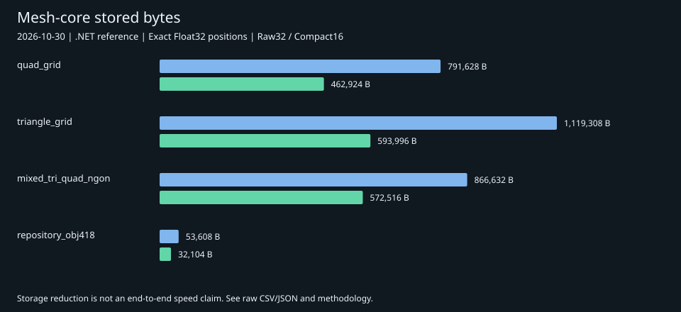

# Mesh-core benchmarks

Measured **2026-10-30, 23:32:20 EDT** (run `20261031T033106Z`).
Published with the original run date; reorganizing the repository is not a new run.

[Storage chart](results/storage.svg) |
[Raw JSON](results/20261031T033106Z.json) |
[CSV](results/20261031T033106Z.csv) |
[Measured source](results/20261031T033106Z.cs)



## Aligned profiles

Both profiles preserve Float32 bits and ordered topology. COMPACT16 uses 16-bit
IDs where possible; it does not quantize positions. These profile names describe
the .NET reference. The Python API's corresponding profiles are RAW32 and COMPACT.

Times below are microseconds per decode. Fresh output allocates new arrays;
reused output retains arrays between calls. The distinction matters: reduced
storage does not guarantee faster allocating decode.

| Fixture | RAW32 bytes | Compact bytes | Saved | Raw fresh us | Compact fresh us | Raw reuse us | Compact reuse us |
| --- | ---: | ---: | ---: | ---: | ---: | ---: | ---: |
| quad_grid | 791,628 | 462,924 | 41.5% | 56.40 | 162.10 | 17.49 | 14.14 |
| triangle_grid | 1,119,308 | 593,996 | 46.9% | 97.00 | 101.18 | 28.20 | 14.10 |
| shuffled_quad_ids | 791,628 | 462,924 | 41.5% | 59.72 | 152.36 | 16.95 | 11.97 |
| mixed_tri_quad_ngon | 866,632 | 572,516 | 33.9% | 264.66 | 110.62 | 21.95 | 16.36 |
| disjoint_ngons | 3,401,288 | 3,401,288 | 0.0% | 422.91 | 416.26 | 119.42 | 117.84 |
| random_triangle_indices | 855,020 | 494,620 | 42.2% | 254.53 | 100.57 | 20.58 | 11.64 |
| repository_obj418 | 53,608 | 32,104 | 40.1% | 16.46 | 10.75 | 1.08 | 0.61 |
| loose_nonmanifold | 228 | 186 | 18.4% | 0.23 | 0.24 | 0.11 | 0.12 |
| float_bit_patterns | 140 | 118 | 15.7% | 0.23 | 0.31 | 0.12 | 0.11 |
| wire_only | 116 | 108 | 6.9% | 0.21 | 0.38 | 0.11 | 0.10 |
| empty_mesh | 64 | 64 | 0.0% | 0.22 | 0.19 | 0.10 | 0.10 |

## Retained memory and smaller experimental packets

Memory is the final decoded array payload, not peak process RAM or GPU memory.
The smallest packet is selected by bytes across all ten tested profiles; it may
be substantially slower. Experimental profiles are not supported by the Python
reader or Blender extension.

| Fixture | Raw array bytes | Compact array bytes | Smallest profile | Packet bytes | Reuse decode us |
| --- | ---: | ---: | --- | ---: | ---: |
| quad_grid | 791,564 | 462,860 | face_templates | 114,823 | 796.04 |
| triangle_grid | 1,119,244 | 593,932 | face_templates | 257,643 | 1393.32 |
| shuffled_quad_ids | 791,564 | 462,860 | edge_delta | 275,603 | 1425.59 |
| mixed_tri_quad_ngon | 866,568 | 572,452 | face_templates | 199,903 | 1098.18 |
| disjoint_ngons | 3,401,224 | 3,401,224 | face_templates | 1,025,297 | 6283.75 |
| random_triangle_indices | 854,956 | 494,556 | edge_delta | 420,964 | 1690.79 |
| repository_obj418 | 53,544 | 32,040 | edge_delta | 23,587 | 92.54 |
| loose_nonmanifold | 164 | 122 | lanes256 | 117 | 0.57 |
| float_bit_patterns | 76 | 54 | packed | 103 | 0.14 |
| wire_only | 52 | 44 | lanes256 | 97 | 0.20 |
| empty_mesh | 0 | 0 | raw32 | 64 | 0.10 |

## Method and boundaries

- Implementation: .NET 9 Release JIT, tiered compilation disabled.
- Host: Windows 10 build 19045; captured CPU identifier: AMD64 Family 25 Model 33
  Stepping 0, AuthenticAMD. The run did not capture the marketing CPU model,
  power settings or affinity. Those details cannot be reconstructed from results.
- Input: 11 hash-verified fixtures, ten encodings each: **110 exact cases**.
- Per packet: fresh process, 25 warm-up decodes, nine batches of 25 decodes.
  Report the median batch time per decode. Fresh and reused output measured separately.
- Position bytes, face sizes, face/corner ordering and explicit edge endpoint
  order are verified for both fresh and reused decoding by the reference encoder.
- Input is already in memory. Disk I/O, Blender construction, triangulation,
  GPU upload and full scene loading are excluded.
- Retained bytes count output arrays only. Managed allocation measurements use
  the current thread and include output plus transient allocations and small
  amortized timing overhead. Neither is peak process RAM.
- Profiles ran in fixed order, without randomized trials or confidence intervals.
  Tiny timings are sensitive to the host and should not be treated as guarantees.

The GLB-derived fixture contains positions and ordered triangle indices from
Zorak's mesh asset, with a derived edge list. It excludes UVs, colors, normals,
materials and other GLB contents. The other fixtures are synthetic or exactness
stress inputs. No full GLB-versus-ZPM comparison is claimed.

## Reproduce

Requirements: Python 3.11+ and **.NET SDK 9.0.306** on PATH. No Python dependencies
are needed for this benchmark. The SDK pin preserves the historical build environment.

```sh
python tools/verify_benchmarks.py
python benchmarks/mesh-core/run.py --verify-only
python benchmarks/mesh-core/run.py
```

The runner builds the frozen reference, verifies fixture hashes and reconstructs
every encoded packet before measurement. New runs go to the ignored `runs/`
folder. Review a run before publishing its JSON, CSV and matching source snapshot.
Keep historical results unchanged; compare changed implementations as new runs.

To regenerate the chart from the published run:

```sh
python tools/render_benchmark_chart.py
```

## Files and provenance

| Path | Contents |
| --- | --- |
| `reference/Program.cs` | Frozen measured reference codec and timing worker |
| `reference/global.json` | Historical SDK pin |
| `fixtures/manifest.json` | Fixture names, scope and SHA-256 hashes |
| `fixtures/*.zms` | Exact benchmark inputs, approximately 7.9 MB total |
| `results/*.json`, `*.csv` | Public measurements and captured environment |
| `results/*.cs` | Exact measured source snapshots |
| `results/storage.svg` | Static stored-size chart generated from the measurements |

Fixtures and reference code are provided under the repository's GPL-3.0-or-later
license. The source asset hash is recorded in the manifest; no external download
or website checkout is required to reproduce the included fixtures.
